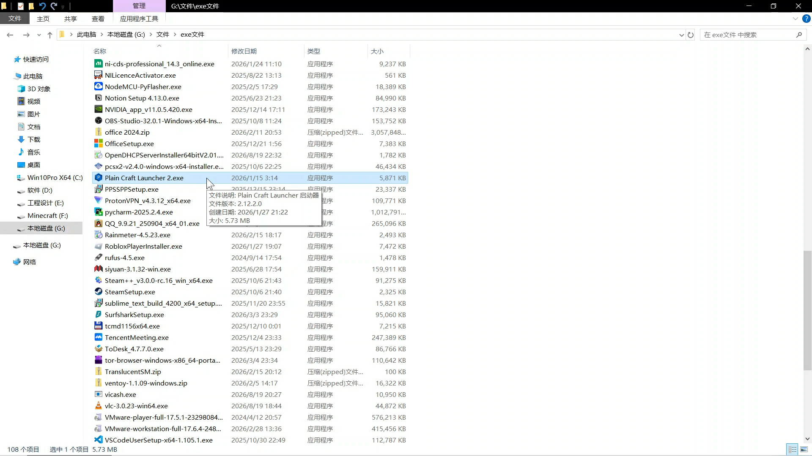
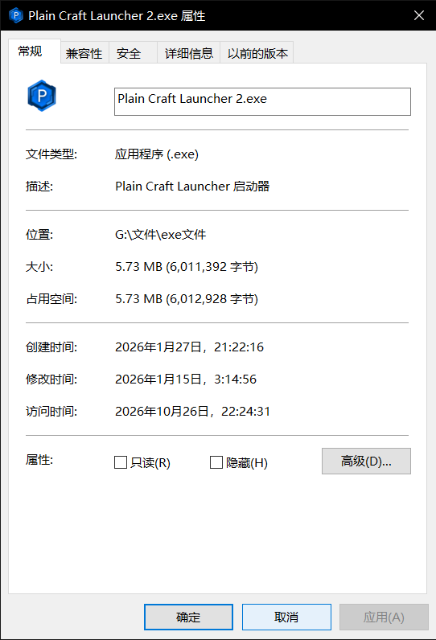

这是我之前下载并保留的的PCL2安装包  
2026‎年‎1‎月‎27‎日21时，还是比较新的  
SHA256:`6c3aee9f1ca9b58af20cf1324627d345e81036df6c29001c12064487ef6b9ccf`

---

我还没试能不能正常运行。按道理来讲应该是可以的。

打开后会强制要求你点更新。  
点了“更新”之后，以最快速度 右键点击任务栏中的PCL图标，选择关闭软件  
再次重启，即可恢复正常

> 直接按`Alt + F4`或许更快，更便捷  
> 但我没试过，不知是否可行

---

说来也巧，我有个保留安装包的习惯，会不定时备份安装包  
本来想为了避免某个软件突然收费了，能够回退到老版本继续白嫖  
没想到今天在这用上了（笑哭

相信我，没有病毒。我愿以吾王HIM发誓（狗头  
（不信就别用，不要来质问我）

